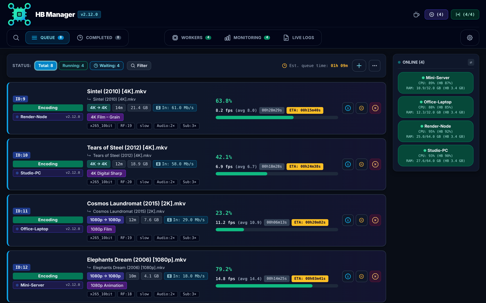
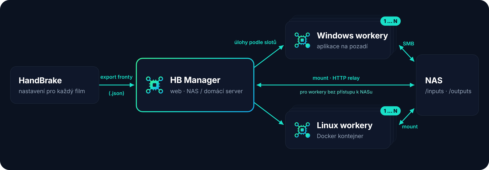
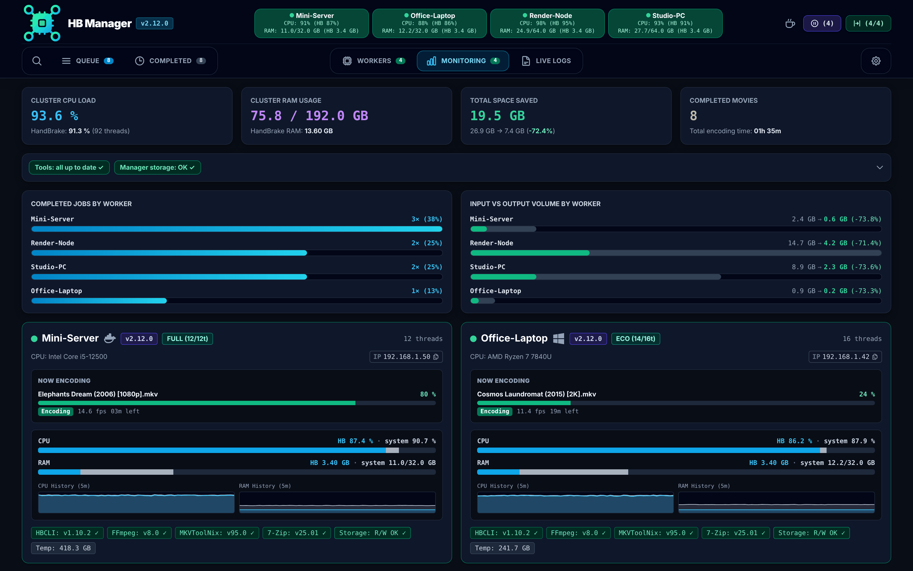
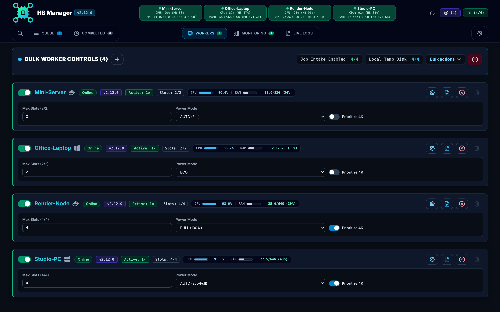
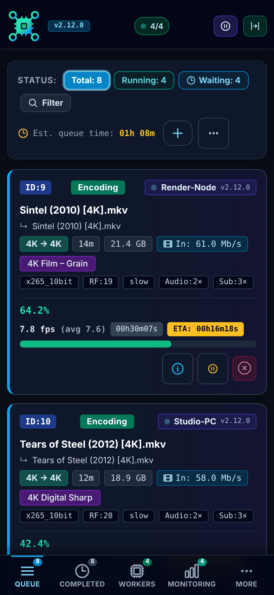
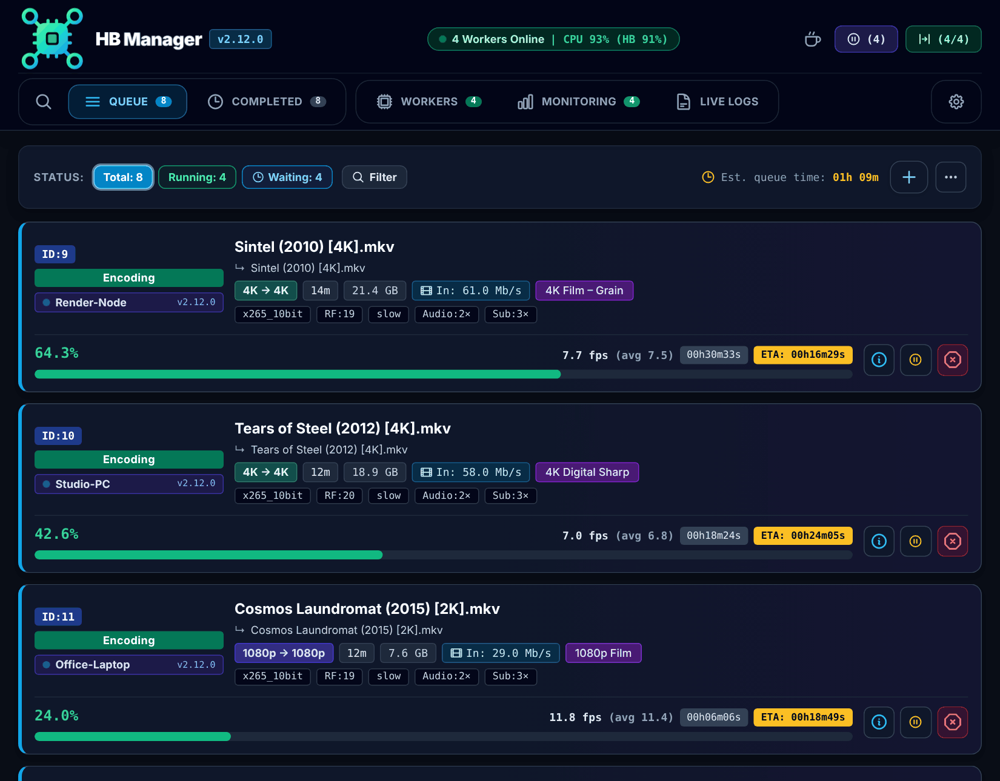

<p align="center">
  
</p>

<h1 align="center">HB Cluster</h1>

<p align="center">
  <b>Distribuované kódování v HandBrake pro domácí lab.</b><br/>
  Nastavte si každý film v HandBrake po svém – a nechte ho převádět všechny své počítače najednou.
</p>

<p align="center">
  <a href="https://github.com/maseklab/hb-cluster/actions/workflows/docker-publish.yml"></a>
  <a href="https://github.com/maseklab/hb-cluster/releases/latest"></a>
  <a href="https://github.com/maseklab/hb-cluster/pkgs/container/hb-manager"></a>
  <a href="https://github.com/maseklab/hb-cluster/pkgs/container/hb-worker"></a>
  <a href="LICENSE"></a>
  <a href="https://ko-fi.com/maseklab"></a>
</p>

<p align="center">
  <a href="README.md">English</a> · <b>Česky</b> ·
  <a href="#rychly-start">Rychlý start</a> ·
  <a href="docs/cs/workers.md">Workery</a> ·
  <a href="docs/cs/security.md">Zabezpečení</a> ·
  <a href="docs/cs/faq.md">Časté otázky</a>
</p>

<p align="center">
  
</p>

---

## Co je HB Cluster?

**HB Cluster** spojí vaše počítače s Windows a Linuxem do jednoho kódovacího clusteru pro HandBrake. Úlohy si připravíte v klasickém desktopovém **HandBrake** – preset, kvalitu RF, ořez, filtry, zvukové stopy a titulky pro každý film – frontu vyexportujete jako `.json` a přetáhnete do webového rozhraní **HB Manageru**. Manager práci rozdělí mezi všechny dostupné stroje, pohlídá ji a hotové `.mkv` uloží tam, kam patří.

- 🎯 **Vaše nastavení pro každý film** – nic nerozhoduje jedno společné pravidlo, každá úloha si nese přesně to, co jste nastavili v HandBrake. Jde i celá složka s jedním presetem.
- 🖥️ **Všechny stroje najednou** – Windows počítače a notebooky, Linux servery v Dockeru; úlohy se rozdělují podle **vážených slotů** (4K = 4, 1080p = 2, SD = 1).
- 💿 **Blu-ray složky a `.iso`** – výběr playlistu (`.MPLS`) a volitelný Smart Pre-Mux (beta), bezztrátové LPCM, DTS core, čisté titulky.
- 📱 **Ovládání z jednoho místa** – fronta, monitoring, živé logy, statistiky; funguje i na mobilu a jde nainstalovat jako aplikace.
- 🔄 **Aktualizuje se sám** – Manager i workery jedním klepnutím (nebo automaticky); workery napřed dokončí rozpracovanou úlohu.
- 🔒 **Volitelné zabezpečení** – přihlášení do webu, passkeys, schvalování nových workerů. Ve výchozím stavu vypnuté, viz [Zabezpečení](docs/cs/security.md).

## Jak to funguje

<p align="center"></p>

Workery čtou zdroj přímo z NASu (nebo přes HTTP relay Manageru, když k NASu nemají přístup), převádějí na rychlém lokálním disku a hotový soubor nahrají zpět.

## Jak projekt vznikl

Filmy převádím v HandBrake přímo na procesoru, protože tak dostanu nejlepší kvalitu obrazu při co nejmenší velikosti. Preset, hodnotu RF a další nastavení volím pro každý film zvlášť, podle toho, jak byl natočený – starý film se zrnem potřebuje jiné nastavení než ostrý digitální záznam nebo animace. Automatické nástroje, které převádějí celou knihovnu podle jednoho pravidla, mi proto nevyhovovaly. Kódování na procesoru je ale pomalé a zapojit víc počítačů znamenalo pouštět HandBrake na každém zvlášť, dělit fronty a hlídat, co kde doběhlo. Chtěl jsem nástroj, který převod s mým nastavením rozloží na víc počítačů a dá se ovládat z jednoho místa. Tak vznikl malý soukromý projekt, ze kterého postupně vyrostl celý cluster. Teď ho dávám k dispozici i ostatním – třeba se bude hodit i vám.

<a id="rychly-start"></a>
## Rychlý start (asi 5 minut)

1. **Spusťte Manager** v Dockeru (NAS, domácí server nebo jakýkoli Linux) – compose níže.
2. Otevřete **`http://<server>:8383`** – 4krokový úvodní průvodce nastaví jazyk a sdílené složky, pomůže přidat první worker, umožní nastavit zpracování videa (HandBrake vs. post-processing) a volitelně přihlášení do webu.
3. **Přidejte worker** – v Manageru **Workery → +** (nebo 2. krok průvodce): stáhněte předvyplněný balíček pro Windows, nebo zkopírujte vygenerovaný Docker compose pro Linux.
4. V desktopovém **HandBrake** připravte filmy, přidejte je do fronty a vyexportujte ji jako `.json` (okno Fronta → **Exportovat frontu**).
5. **Přetáhněte `.json` kamkoli na stránku Manageru** (nebo klepněte na **+** nad frontou) – převod začne.

### Manager – `docker-compose.yml`

```yaml
services:
  hb-manager:
    image: ghcr.io/maseklab/hb-manager:latest
    container_name: hb-manager
    restart: unless-stopped
    # Doporučeno: síť hostitele. Manager pak vidí skutečné adresy vašich zařízení
    # (přihlášení z domácí sítě, reverse proxy, IP workerů) a Windows workery ho v síti najdou
    # samy (TCP + UDP 8383). Port 8383 na hostiteli musí být volný.
    network_mode: host
    # Bez režimu host použijte místo toho mapování portů. Funguje to taky, ale na některých
    # systémech (např. NAS jako Synology, Docker Desktop, rootless Docker/Podman) pak Manager místo
    # vašich zařízení vidí jen bránu Dockeru: „Z domácí sítě bez přihlášení“ a reverse proxy zůstanou
    # zamčené a u Linux workerů se neukáže IP adresa.
    # ports:
    #   - "8383:8383/tcp"
    #   - "8383:8383/udp"
    environment:
      - TZ=Europe/Prague
    volumes:
      - ./data:/data                               # databáze, nastavení, logy, nástroje (NAS/Portainer: absolutní cesta, např. /volume1/docker/hb_manager/data:/data)
      - /mnt/nas/inputs:/inputs:ro                 # zdrojová videa (jen pro čtení)
      - /mnt/nas/outputs:/outputs                  # hotové .mkv
      - /var/run/docker.sock:/var/run/docker.sock  # doporučeno: aktualizace jedním klepnutím / automaticky řízené Managerem bez ohrožení běžících úloh
      # - ./watch_dir:/watch_dir                   # volitelné: složka pro automatický import front .json
    labels:
      - "com.centurylinklabs.watchtower.enable=false"  # aktualizace řídí HB Manager
```

Workery pak přidáte z Manageru – viz **[Workery](docs/cs/workers.md)** (balíček pro Windows, compose pro Linux, sloty, režimy výkonu).

## Ukázky

| Monitoring | Workery | Mobil |
|---|---|---|
|  |  |  |

<p align="center"></p>

<sub>Snímky ukazují zkušební cluster s otevřenými filmy <a href="https://studio.blender.org/films/">Blender Studia</a> (CC BY); animace je zrychlená.</sub>

## Požadavky

| Část | Běží na | Poznámka |
|---|---|---|
| **HB Manager** | Docker na Linuxu (amd64) – NAS, domácí server, PC | Vyzkoušeno na Debianu a Synology DSM. Doporučený `network_mode: host`. ARM je v plánu. |
| **Linux worker** | Docker na Linuxu (amd64) | Compose vygeneruje Manager. Sestavuje statické HandBrakeCLI / FFmpeg pro celý cluster. |
| **Windows worker** | Windows 10 / 11 (x64) | Přenosný balíček z Manageru. Python se při prvním spuštění doinstaluje sám, jen pokud v počítači chybí. |
| **Prohlížeč** | Aktuální Chrome, Edge, Firefox, Safari – počítač i mobil | Jde nainstalovat jako aplikace (PWA). |

## Dokumentace

- **[Kódování a funkce](docs/cs/encoding.md)** – vážené sloty, CPU pipeline do `.mkv`, Blu-ray / ISO, Pre-Mux, titulky, HTTP relay, ochrana místa, nástroje.
- **[Workery](docs/cs/workers.md)** – instalace pro Windows a Linux, režimy spouštění a výkonu, aktualizace.
- **[Zabezpečení a přístup zvenku](docs/cs/security.md)** – přihlášení do webu, passkeys, schvalování workerů, HTTPS, reverse proxy, režim host.
- **[Časté otázky a řešení potíží](docs/cs/faq.md)**
- **[Historie změn](CHANGELOG.md)**

## Soukromí

HB Cluster **nesbírá žádnou telemetrii**. Manager se připojuje jen ke GitHubu (kontrola aktualizací, Docker obrazy) a k oficiálním zdrojům kódovacích nástrojů (HandBrake, FFmpeg, MKVToolNix, 7-Zip), když je sestavuje nebo aktualizuje. Workery komunikují jen s vaším Managerem; Windows worker navíc doinstaluje Python z wingetu nebo python.org, pokud chybí.

## Plánovaný vývoj

- **Kódování na grafice** – profily NVIDIA NVENC, Intel QuickSync, AMD vedle kódování na procesoru.
- **Tvorba úloh v prohlížeči** – výběr videí, stop a presetů přímo v Manageru bez exportu `.json`.
- **Režim Turbo** – rozdělit jeden dlouhý film na části, převést je na všech workerech najednou a spojit.
- **Motivy vzhledu** – světlý, tmavý, OLED černý a další.
- **ARM** – Manager a workery pro Raspberry Pi a ARM NAS; šablona pro Unraid.

## Podpora

Pokud vám HB Cluster šetří čas, můžete mi koupit kafe (nebo večerní pivo):

[](https://ko-fi.com/maseklab)

Našli jste chybu nebo máte nápad? Založte [issue](https://github.com/maseklab/hb-cluster/issues). Bezpečnostní problémy prosím hlaste neveřejně – viz [SECURITY.md](SECURITY.md).

## Licence a nástroje třetích stran

**HB Cluster** (HB Manager a HB Worker) je šířen pod licencí **[MIT](LICENSE)** – © 2026 MasekLab / Petr Mašek.

Software je poskytován **„tak, jak je“**, bez jakékoli záruky. Používáte ho na vlastní riziko; před smazáním originálů vždy zkontrolujte převedené soubory. Autor neodpovídá za ztrátu dat, poškozené soubory ani opotřebení hardwaru při dlouhé a vysoké zátěži.

HB Cluster je samostatný nástroj pro řízení převodů. Stahuje nebo sestavuje neupravené nástroje třetích stran z jejich oficiálních zdrojů; zůstávají majetkem svých autorů a řídí se vlastními licencemi:

- [HandBrake / HandBrakeCLI](https://handbrake.fr/) – GPL-2.0
- [FFmpeg / FFprobe](https://ffmpeg.org/) – LGPL-2.1+ / GPL-2.0+ (statická sestavení)
- [MKVToolNix](https://mkvtoolnix.download/) (`mkvmerge`, `mkvpropedit`) – GPL-2.0
- [7-Zip](https://www.7-zip.org/) (`7z`, `7zz`) – LGPL-2.1+ / BSD-3-Clause
- Webové rozhraní: [Vue.js](https://vuejs.org/), [SortableJS](https://sortablejs.github.io/Sortable/), [Tailwind CSS](https://tailwindcss.com/) – MIT
- Python a jeho knihovny (FastAPI, Uvicorn, SQLAlchemy, Pydantic, Requests, psutil, Pillow, smbprotocol, py_webauthn …) – PSF / MIT / BSD / Apache-2.0; Windows worker instaluje oficiální [Python pro Windows](https://www.python.org/) (licence PSF)
- Docker obrazy vycházejí z Debianu (`python:3.11-slim-bookworm`); zdrojový kód každého obsaženého balíčku Debianu najdete na [sources.debian.org](https://sources.debian.org/)

Úplný seznam s názvy licencí a odkazy na zdrojové kódy je v souboru **[THIRD-PARTY-NOTICES.md](THIRD-PARTY-NOTICES.md)**.

HB Cluster není nijak spojen s projekty HandBrake, FFmpeg, MKVToolNix ani 7-Zip, ani jimi není schválen či sponzorován. Všechny názvy produktů a ochranné známky patří jejich vlastníkům.

---

<sub>**Jak vzniká:** HB Cluster je hobby projekt jednoho člověka. Vznikl s velkou pomocí AI asistentů pro programování (Claude, Gemini) a měsíce ho testuji na vlastním clusteru Windows a Linux počítačů, na kterém jsem převedl stovky filmů. Každé vydání sám kontroluji, testuji a udržuji.</sub>
