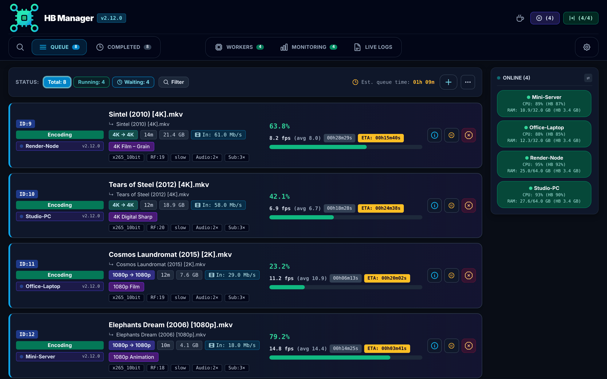
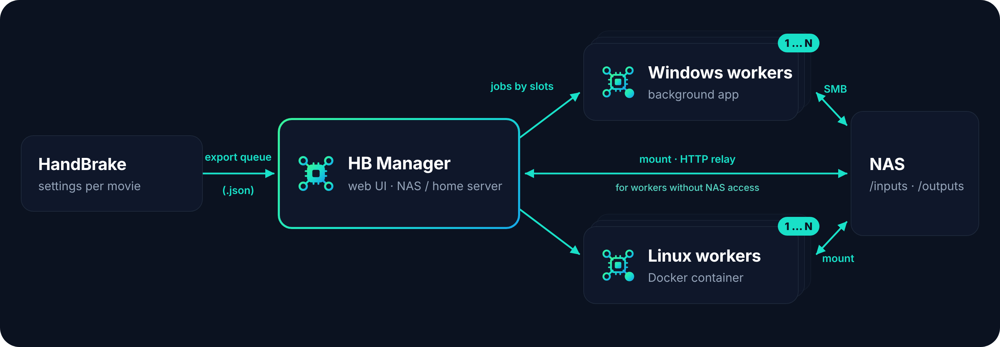
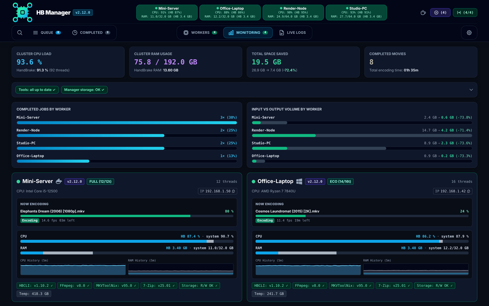
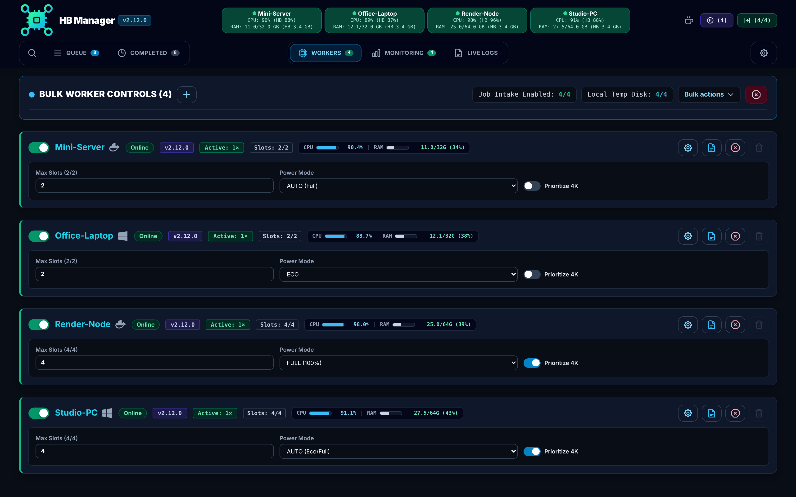
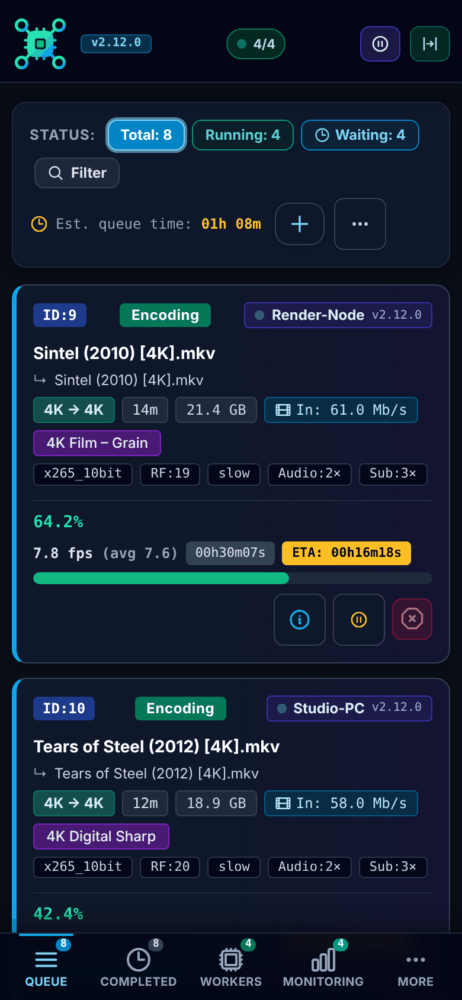
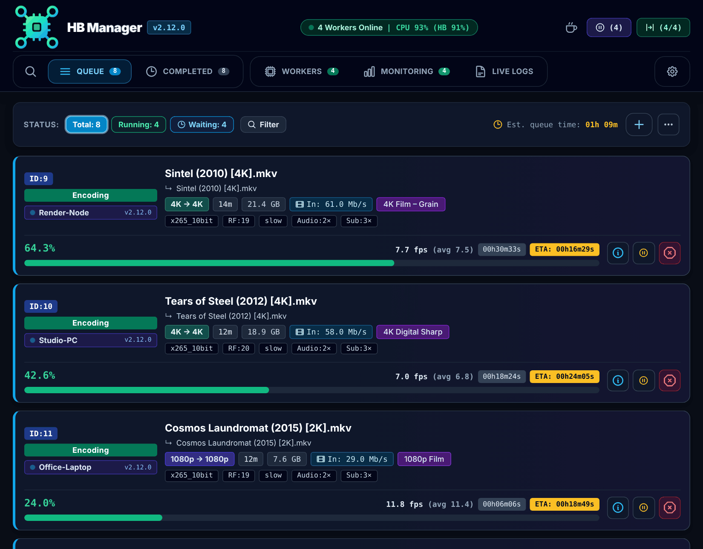

<p align="center">
  
</p>

<h1 align="center">HB Cluster</h1>

<p align="center">
  <b>Distributed HandBrake encoding for your home lab.</b><br/>
  Tune every movie in HandBrake the way you want – and let all your computers encode it together.
</p>

<p align="center">
  <a href="https://github.com/maseklab/hb-cluster/actions/workflows/docker-publish.yml"></a>
  <a href="https://github.com/maseklab/hb-cluster/releases/latest"></a>
  <a href="https://github.com/maseklab/hb-cluster/pkgs/container/hb-manager"></a>
  <a href="https://github.com/maseklab/hb-cluster/pkgs/container/hb-worker"></a>
  <a href="LICENSE"></a>
  <a href="https://ko-fi.com/maseklab"></a>
</p>

<p align="center">
  <b>English</b> · <a href="README.cs.md">Česky</a> ·
  <a href="#quick-start">Quick start</a> ·
  <a href="docs/workers.md">Workers</a> ·
  <a href="docs/security.md">Security</a> ·
  <a href="docs/faq.md">FAQ</a>
</p>

<p align="center">
  
</p>

---

## What is HB Cluster?

**HB Cluster** turns your Windows and Linux computers into one HandBrake encoding cluster. You prepare jobs in the familiar desktop **HandBrake** – preset, RF quality, crop, filters, audio and subtitle tracks for every movie – export the queue as `.json` and drop it into the **HB Manager** web interface. The Manager splits the work across all available machines, watches it, and the finished `.mkv` files end up where they belong.

- 🎯 **Your settings, per title** – nothing is decided by a global rule; every job keeps exactly what you set in HandBrake. A whole folder with one preset works too.
- 🖥️ **All your machines at once** – Windows PCs and laptops, Linux servers in Docker; jobs are distributed by **weighted slots** (4K = 4, 1080p = 2, SD = 1).
- 💿 **Blu-ray folders and `.iso`** – playlist (`.MPLS`) selection and optional Smart Pre-Mux (beta), lossless LPCM, DTS core, clean subtitles.
- 📱 **One place to control it** – queue, monitoring, live logs, statistics; works on a phone and installs as an app.
- 🔄 **Updates itself** – Manager and workers update with one click (or automatically); workers finish their current job first.
- 🔒 **Optional security** – web sign-in, passkeys, approval of new workers. Off by default, see [Security](docs/security.md).

## How it works

<p align="center"></p>

Workers read the source directly from your NAS (or through the Manager's HTTP relay when they cannot reach it), encode on a fast local disk and upload the finished file back.

## How it started

I encode my movies in HandBrake on the CPU, because that gives the best picture quality at the smallest size. I choose the preset, RF value and other settings for each movie separately, depending on how it was shot – a grainy film transfer needs different settings than a crisp digital recording or an animation. Tools that convert a whole library by one rule therefore didn't work for me. CPU encoding is slow, though, and using more computers meant starting HandBrake on each one, splitting queues and checking what had finished where. I wanted a tool that spreads the work with my settings across machines and is controlled from one place. It began as a small personal project and grew into a full cluster. Now I'm sharing it – maybe it will be useful to you too.

<a id="quick-start"></a>
## Quick start (about 5 minutes)

1. **Start the Manager** in Docker (NAS, home server or any Linux machine) – compose below.
2. Open **`http://<server>:8383`** – the 4-step first-run wizard sets the language and shared folders, helps add your first worker, lets you configure Video Processing (HandBrake vs. post-processing) and optional web sign-in.
3. **Add a worker** – in the Manager open **Workers → +** (or step 2 of the wizard): download the pre-configured Windows package, or copy the generated Docker compose for Linux.
4. In desktop **HandBrake** prepare your movies, add them to the queue and export it as `.json` (Queue window → **Export Queue**).
5. **Drop the `.json` anywhere on the Manager page** (or click **+** above the queue) – encoding starts.

### Manager – `docker-compose.yml`

```yaml
services:
  hb-manager:
    image: ghcr.io/maseklab/hb-manager:latest
    container_name: hb-manager
    restart: unless-stopped
    # Recommended: host network. The Manager then sees the real addresses of your devices
    # (sign-in from the home network, reverse proxy, worker IPs) and Windows workers can find it
    # automatically on the LAN (TCP + UDP 8383). Port 8383 on the host must be free.
    network_mode: host
    # Without host mode, use port mapping instead. Works too, but on some systems
    # (e.g. a NAS like Synology, Docker Desktop, rootless Docker/Podman) the Manager then sees
    # only the Docker gateway instead of your devices: "no sign-in from the home network" and the
    # reverse proxy option stay locked and Linux worker IPs are not shown.
    # ports:
    #   - "8383:8383/tcp"
    #   - "8383:8383/udp"
    environment:
      - TZ=UTC                                     # your timezone, e.g. America/New_York, Europe/London
    volumes:
      - ./data:/data                               # database, settings, logs, tools (NAS/Portainer: absolute path, e.g. /volume1/docker/hb_manager/data:/data)
      - /mnt/nas/inputs:/inputs:ro                 # source videos (read-only)
      - /mnt/nas/outputs:/outputs                  # finished .mkv files
      - /var/run/docker.sock:/var/run/docker.sock  # recommended: Manager-orchestrated 1-click/automatic updates without interrupting running jobs
      # - ./watch_dir:/watch_dir                   # optional: folder for automatic .json queue import
    labels:
      - "com.centurylinklabs.watchtower.enable=false"  # updates are handled by HB Manager
```

Then add workers from the Manager – see **[Workers](docs/workers.md)** (Windows package, Linux compose, slots, power modes).

## Screenshots

| Monitoring | Workers | Phone |
|---|---|---|
|  |  |  |

<p align="center"></p>

<sub>Screenshots show a demo cluster with the open movies of the <a href="https://studio.blender.org/films/">Blender Studio</a> (CC BY); the animation is sped up.</sub>

## Requirements

| Part | Runs on | Notes |
|---|---|---|
| **HB Manager** | Docker on Linux (amd64) – NAS, home server, PC | Tested on Debian and Synology DSM. Recommended `network_mode: host`. ARM is planned. |
| **Linux worker** | Docker on Linux (amd64) | Compose is generated by the Manager. Builds static HandBrakeCLI / FFmpeg for the whole cluster. |
| **Windows worker** | Windows 10 / 11 (x64) | Portable package from the Manager. Python is installed automatically on first start, only if it is missing. |
| **Browser** | Current Chrome, Edge, Firefox, Safari – desktop or phone | Can be installed as an app (PWA). |

## Documentation

- **[Encoding & features](docs/encoding.md)** – weighted slots, CPU `.mkv` pipeline, Blu-ray / ISO, Pre-Mux, subtitles, HTTP relay, storage guard, tools.
- **[Workers](docs/workers.md)** – Windows and Linux installation, startup modes, power modes, updates.
- **[Security & remote access](docs/security.md)** – web sign-in, passkeys, worker approval, HTTPS, reverse proxy, host mode.
- **[FAQ & troubleshooting](docs/faq.md)**
- **[Changelog](CHANGELOG.md)**

## Privacy

HB Cluster has **no telemetry**. The Manager connects only to GitHub (update checks, Docker images) and to the official download sources of the encoding tools (HandBrake, FFmpeg, MKVToolNix, 7-Zip) when it builds or updates them. Workers talk only to your Manager; a Windows worker also installs Python from winget or python.org if it is missing.

## Roadmap

- **GPU encoding** – NVIDIA NVENC, Intel QuickSync, AMD profiles alongside CPU encoding.
- **Job builder in the browser** – choose videos, tracks and presets in the Manager without exporting `.json`.
- **Turbo mode** – split one long movie into segments, encode them on all workers at once and join them.
- **Themes** – light, dark, OLED black and more.
- **ARM** – Manager and workers for Raspberry Pi and ARM NAS; Unraid template.

## Support

If HB Cluster saves you time, you can buy me a coffee (or an evening beer):

[](https://ko-fi.com/maseklab)

Found a bug or have an idea? Open an [issue](https://github.com/maseklab/hb-cluster/issues). Security problems please report privately – see [SECURITY.md](SECURITY.md).

## License & third-party tools

**HB Cluster** (HB Manager & HB Worker) is released under the **[MIT License](LICENSE)** – © 2026 MasekLab / Petr Mašek.

The software is provided **"as is"**, without warranty of any kind. Use it at your own risk; always check the encoded files before deleting the originals. The author is not liable for data loss, damaged files or hardware wear caused by long, heavy encoding load.

HB Cluster is an independent orchestration tool. It downloads or builds unmodified third-party tools from their official sources; they remain the property of their authors and are covered by their own licenses:

- [HandBrake / HandBrakeCLI](https://handbrake.fr/) – GPL-2.0
- [FFmpeg / FFprobe](https://ffmpeg.org/) – LGPL-2.1+ / GPL-2.0+ (static builds)
- [MKVToolNix](https://mkvtoolnix.download/) (`mkvmerge`, `mkvpropedit`) – GPL-2.0
- [7-Zip](https://www.7-zip.org/) (`7z`, `7zz`) – LGPL-2.1+ / BSD-3-Clause
- Web interface: [Vue.js](https://vuejs.org/), [SortableJS](https://sortablejs.github.io/Sortable/), [Tailwind CSS](https://tailwindcss.com/) – MIT
- Python and its libraries (FastAPI, Uvicorn, SQLAlchemy, Pydantic, Requests, psutil, Pillow, smbprotocol, py_webauthn …) – PSF / MIT / BSD / Apache-2.0; the Windows worker installs the official [Python for Windows](https://www.python.org/) (PSF License)
- Docker images are based on Debian (`python:3.11-slim-bookworm`); the source code of every included Debian package is available from [sources.debian.org](https://sources.debian.org/)

The full list with license names and links to the source code is in **[THIRD-PARTY-NOTICES.md](THIRD-PARTY-NOTICES.md)**.

HB Cluster is not affiliated with, endorsed by or sponsored by the HandBrake, FFmpeg, MKVToolNix or 7-Zip projects. All product names and trademarks belong to their respective owners.

---

<sub>**How it's made:** HB Cluster is a one-person hobby project. It was developed with heavy help from AI coding assistants (Claude, Gemini) and has been tested for months on my own cluster of Windows and Linux machines, encoding hundreds of films. I review, test and maintain every release myself.</sub>
